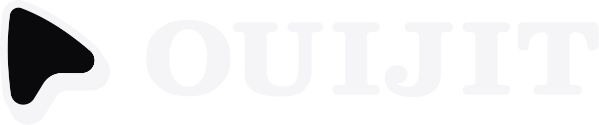
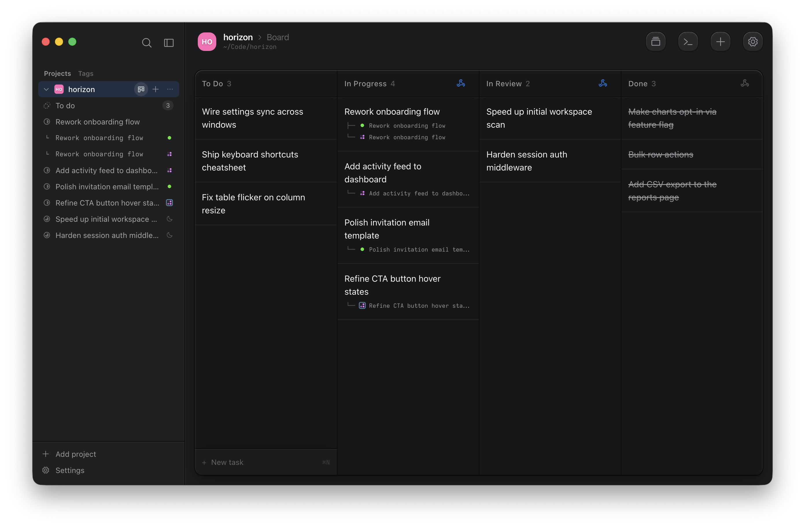
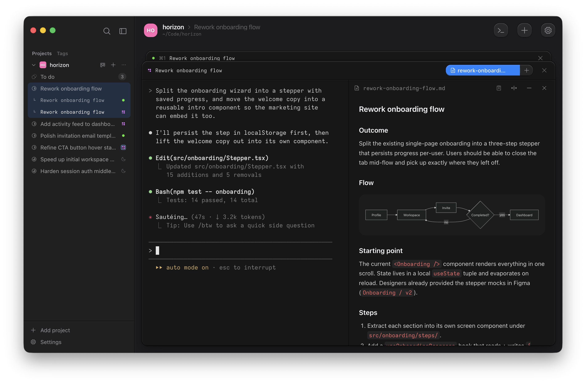
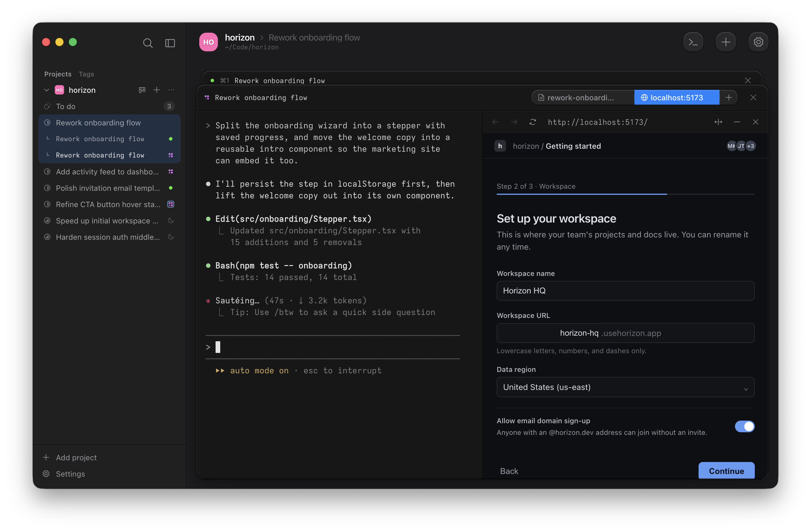
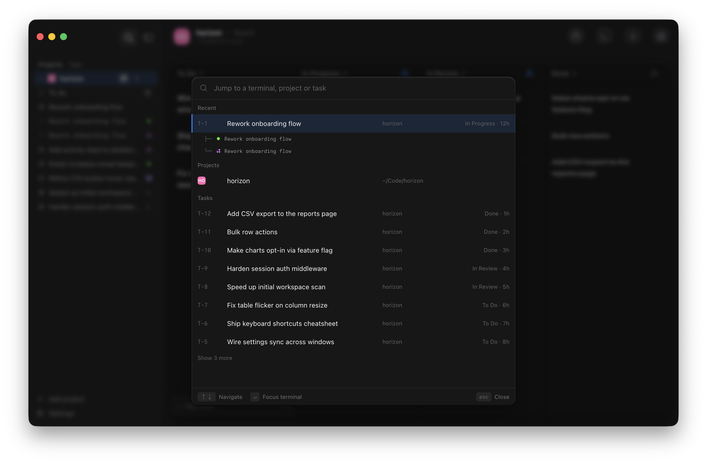
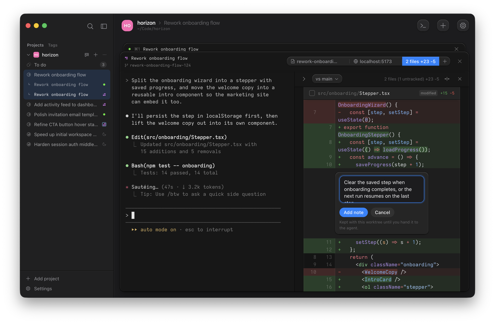
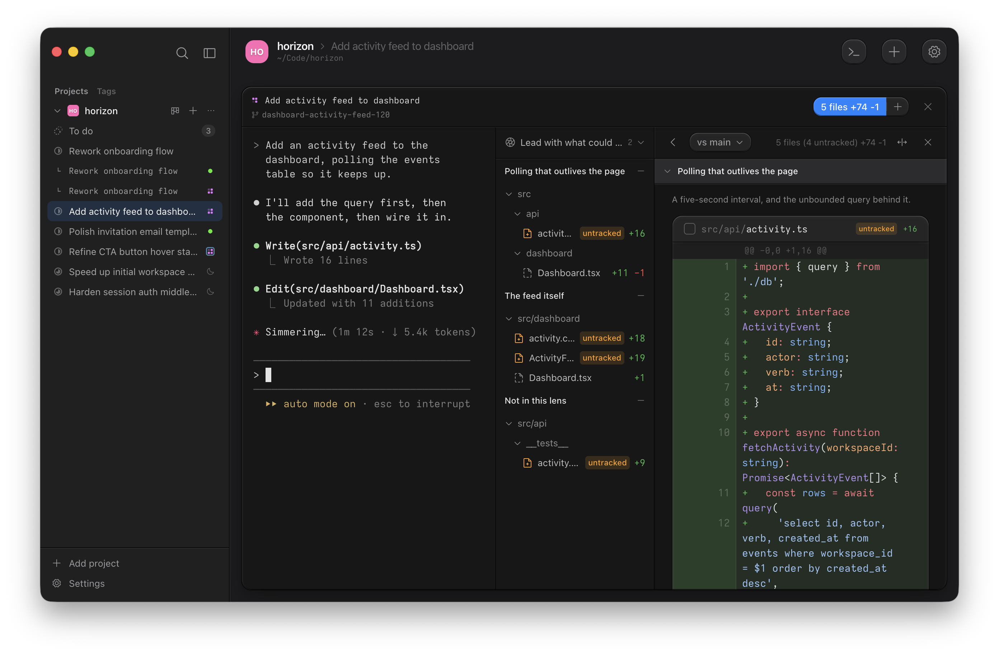
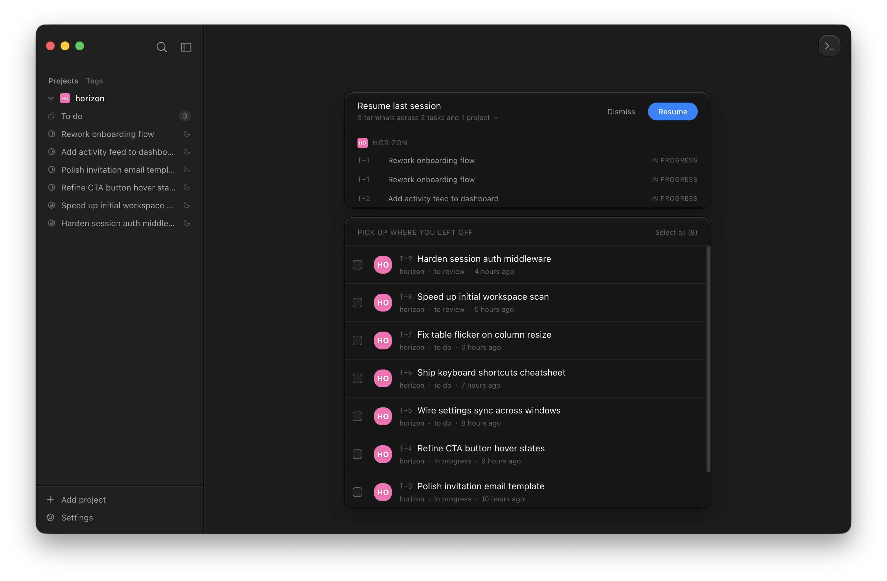
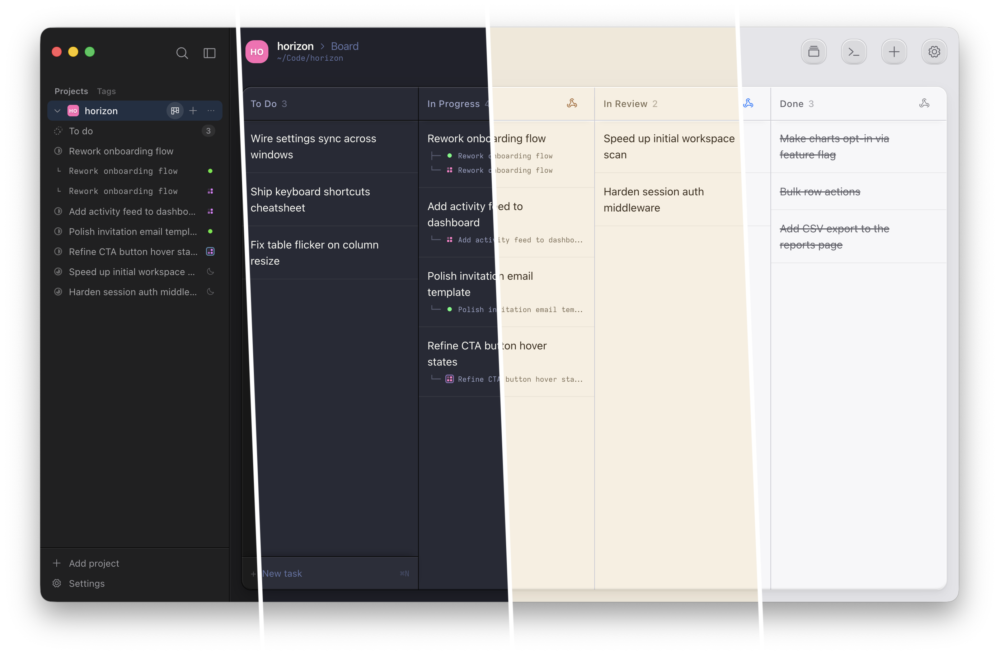

<picture>
  <source media="(prefers-color-scheme: dark)" srcset="website/public/assets/ouijit-logo.svg">
  <source media="(prefers-color-scheme: light)" srcset="website/public/assets/ouijit-logo-dark.svg">
  
</picture>

<br><br>

Ouijit is a task and terminal manager for running Claude Code, Codex, Pi and OpenCode in parallel. Each task gets its own git worktree and terminal. Hooks launch the agent with the task's prompt, and the `ouijit` CLI lets the agent create tasks, move cards and open panels beside itself. Diffs, pull requests and issues are reviewed in the same window, and a note on a diff line goes to the agent working in that worktree. Agents can run sandboxed.

Download the latest release:

- [macOS (Apple Silicon)](https://github.com/ouijit/ouijit/releases/latest/download/ouijit-darwin-arm64.dmg)
- [macOS (Intel)](https://github.com/ouijit/ouijit/releases/latest/download/ouijit-darwin-x64.dmg)
- [Linux (x64)](https://github.com/ouijit/ouijit/releases/latest/download/ouijit-linux-x64.zip)

Free and open source under AGPL-3.0. No account, no sign-in, no telemetry. Everything is stored locally in SQLite.

[Website](https://ouijit.com/) · [Docs](https://ouijit.com/docs/) · [FAQ](https://ouijit.com/faq/) · [All releases](https://github.com/ouijit/ouijit/releases)



## Tasks and worktrees

Tasks live on a kanban board. Dragging a card between To Do, In Progress, In Review, and Done fires the matching lifecycle hook. Starting a task creates an isolated git worktree: a copy-on-write clone with `node_modules` and other gitignored files intact, or a clean checkout if you prefer. Chain tasks off a parent branch, act on several cards at once, set a per-task merge target, and attach images or files to a task's prompt.

## Terminals and panels

Terminals sit in a stack. Panels attach as tabs: a runner for the dev server or any script, a web preview, and markdown files with Mermaid diagrams, so a plan opens beside the agent working from it. Shells outside any task sit in the sidebar beside the tasks. Tag terminals and the Tags view groups them.





## Agents

Inside an Ouijit terminal, `claude`, `codex`, `pi` and `opencode` resolve to wrappers around the real binaries that add status hooks and the `ouijit` CLI reference to the session. Nothing outside Ouijit's terminals changes, and your own settings still apply. Agents can create tasks, advance the board, and open panels with no setup. The board shows each agent's live status, and a sound or OS notification fires when a turn ends.

- [Claude Code](https://claude.com/claude-code)
- [Codex](https://github.com/openai/codex)
- [Pi](https://pi.dev)
- [OpenCode](https://opencode.ai)

To request support for another harness, [open an issue](https://github.com/ouijit/ouijit/issues/new).

## CLI

Every terminal Ouijit opens has the `ouijit` command on PATH, and the supported harnesses get its reference in their context. So you shape the app by asking your agent: it can file follow-up tasks, move its own card, set up hooks, stage review comments, switch themes, or open panels beside itself.

```bash
# "file a task for the flaky login test"
ouijit task create "Fix flaky login test"
# "move this task to review"
ouijit task set-status 5 in_review
# "run claude on every task I start"
ouijit hook set start --name "Agent" --command 'claude "$OUIJIT_TASK_DESCRIPTION"'
# "leave a review comment on PR 116"
ouijit pr draft add 116 --file src/api.ts --line 88 --body "throws when the token is missing"
# "switch to dracula"
ouijit theme use dracula
# "open your plan next to you"
ouijit markdown add ./plan.md
# "show me the app"
ouijit preview add http://localhost:3000
```

It works from your shell too, with JSON output. Full command list in the [docs](https://ouijit.com/docs/cli/).

## Command palette

⌘K (Ctrl+K on Linux) jumps between terminals, projects, tasks, and pull requests, ranked by how often you return to them. Opening an unstarted task creates its worktree on the way.



## Diffs, pull requests, and issues

Every task terminal includes a diff of its worktree against its merge target, uncommitted changes, or any base you pick, with word-level highlighting. Leave a note on a diff line and it goes to the agent working in that worktree, re-anchoring as the code moves. An experimental GitHub surface adds a pull request inbox, review comments staged locally until you send them, and merging. It drives the `gh` CLI, so `gh auth login` is the only setup.

An issues list sits beside it, fed by GitHub, Linear, or both. Each group, from triage to the repo's open issues, is answered by whichever tracker can answer it, so an `ENG-231` and a `#299` sit side by side. Turn an issue into a task and it starts on the branch name Linear suggested; the pull request opened from it carries the identifier, so the issue moves when the work lands.



## Lenses

A lens is a named instruction you keep with the project, like "lead with what could break in production". An agent applies it to one change and answers with the parts of that change: a titled group, a line on why those files belong together, and the hunks that make it up.



## Sandboxing

Run agents with their permission checks off without handing them your machine. Each project picks a default, host or sandbox, and any terminal, hook, runner, or single command (`ouijit sandbox -- claude …`) can go elsewhere, so the agent runs contained while the dev server beside it stays on the host. The sandbox is [nono](https://github.com/nolabs-ai/nono), in place under Seatbelt/Landlock and configured by a profile file per project, or a launcher of your own.

## Session resume

Quitting saves the session. The next launch offers to bring its terminals back in their worktrees, panels included.



## Themes

Choose system, light, dark, or one of five presets, or define your own theme as design-token overrides. Switch in settings or with `ouijit theme use`.



## Everything else

A sidebar across every project, a configurable projects folder, `git init` for folders that need it, an editor launcher, health checks for the agent CLIs, first-run onboarding, terminal font settings, auto-update on macOS with release notes, and a local REST API behind the CLI.

## Setup

Ouijit runs on macOS 13+ (Apple Silicon or Intel) and Linux x64, and needs git 2.20+ on PATH and at least one of the agent CLIs above installed and signed in. The pull request and issues surfaces also need `gh` 2.48 or newer. The downloads above are self-contained.

Building from source also needs Node.js 20+ (the repo pins 22 in `.nvmrc`) and C/C++ build tools for the native modules (better-sqlite3, node-pty, koffi):

- **macOS:** `xcode-select --install`
- **Linux:** `sudo apt install build-essential python3` (Debian/Ubuntu)

```bash
git clone https://github.com/ouijit/ouijit.git
cd ouijit
npm install
npm start
```

## Contributing

Bugs and feature requests go in the [issue tracker](https://github.com/ouijit/ouijit/issues). Pull requests aren't accepted; the code is open so you can read it, build it and fork it.
